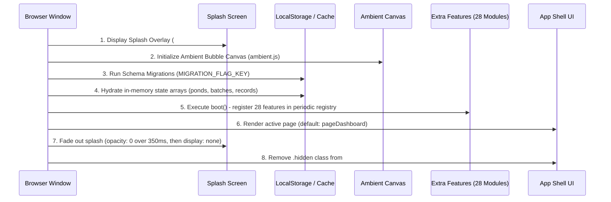
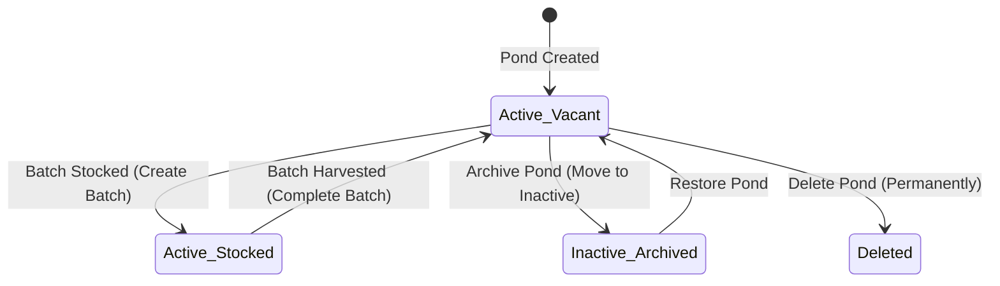
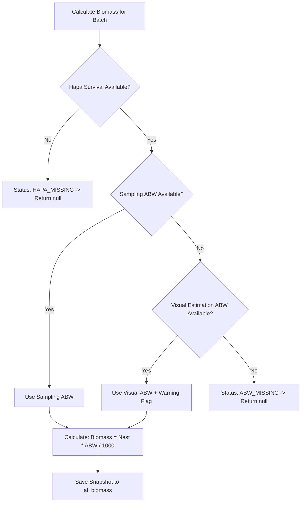

# AquaLog — Complete Business Logic & Architectural Compendium

> **The Definitive End-to-End Logic Specification for Google Stitch**  
> *Reverse-Engineered from 25,000+ Lines of Production Code (`script.js`, `extra-features.js`, `features.js`, `ambient.js`, `style.css`, `sw.js`)*  
> *Target Architecture: Next.js 15 (App Router) / React 19 / TypeScript / Zustand / IndexedDB / Tailwind CSS v4*

---

# Table of Contents
1. [System Boot & Initialization Lifecycle](#1-system-boot--initialization-lifecycle)
2. [Data Layer, Storage Primitives & Caching Architecture](#2-data-layer-storage-primitives--caching-architecture)
3. [Multi-Site & Infrastructure Management Logic](#3-multi-site--infrastructure-management-logic)
4. [Pond Management & Lifecycle State Machine](#4-pond-management--lifecycle-state-machine)
5. [Batch Stocking, Seed Management & Crop Lifecycle](#5-batch-stocking-seed-management--crop-lifecycle)
6. [Biological Monitoring: Hapa, Sampling & Biomass Engine](#6-biological-monitoring-hapa-sampling--biomass-engine)
7. [Precision Feeding, Pellet Mixing & Check-Tray Feedback Loop](#7-precision-feeding-pellet-mixing--check-tray-feedback-loop)
8. [Weather Intelligence & Adaptive Feeding Recommendation Engine](#8-weather-intelligence--adaptive-feeding-recommendation-engine)
9. [Smart Decision Support, Health Scoring & Predictive Analytics](#9-smart-decision-support-health-scoring--predictive-analytics)
10. [Three-Pillar Farm Inventory & Supply Chain Engine](#10-three-pillar-farm-inventory--supply-chain-engine)
11. [Crop Finance, Cost Allocation & Mandi Price Intelligence](#11-crop-finance-cost-allocation--mandi-price-intelligence)
12. [Temporal Reporting, Chart Analytics & History Ledger](#12-temporal-reporting-chart-analytics--history-ledger)
13. [Disaster Recovery, Settings & Internationalization Engine](#13-disaster-recovery-settings--internationalization-engine)
14. [Global Shell, Navigation Dock, Ambient Canvas & Offline PWA](#14-global-shell-navigation-dock-ambient-canvas--offline-pwa)

---

# 1. System Boot & Initialization Lifecycle

### 1.1 Startup Execution Flow
When the user accesses AquaLog (via browser or installed PWA), the boot sequence progresses through strictly guarded stages:



### 1.2 Unified Periodic Interval Registry
Instead of spawning independent `setInterval` loops across features (which causes severe battery drain and thread contention on mobile devices), AquaLog implements a **Unified Periodic Registry** (`periodicCheckers`):
- A single heartbeat runs every **2,500 ms** (`setInterval`).
- Features register their periodic assertions via `registerPeriodicCheck(fn, label)`.
- On each tick, the registry loops through all registered checkers wrapped in defensive `try/catch` guards:
  - **Tasks Widget**: Checks for overdue feed sessions and sampling alerts.
  - **Lifecycle Stage Badges**: Checks if newly rendered pond cards on `pageManage` require lifecycle stage badges.
  - **FCR Tracker**: Checks if the dashboard context requires FCR card injection.
  - **Threshold Monitor**: Checks if inventory items have breached low-stock thresholds.

### 1.3 Service Worker Registration & Caching Strategy (`sw.js`)
- Cache Identifier: `aqualog-v1`.
- **Pre-Cached Assets (`APP_SHELL`)**:
  - Root: `./`, `./index.html`, `./style.css`, `./script.js`, `./manifest.json`.
  - External CDNs: `Chart.js` (Cloudflare CDN), `Tabler Icons` (jsDelivr CDN), Google Fonts (`Outfit`, `Plus Jakarta Sans`, `Noto Sans Devanagari`).
- **Fetch Handler Rules**:
  - **Same-Origin Requests**: **Cache-First** strategy. Returns cached response immediately; falls back to network if absent.
  - **CDN Assets**: If network request succeeds, clones response into cache for subsequent offline sessions.
  - **Navigation Fallback**: If network is unavailable during a page transition, serves cached `index.html`.

---

# 2. Data Layer, Storage Primitives & Caching Architecture

### 2.1 The 18 LocalStorage Domain Keys (`KEYS`)
All application data is serialized under 18 frozen namespaced keys:

| Constant | Storage Key | Domain Scope |
| :--- | :--- | :--- |
| `KEYS.RECORDS` | `al_records` | Granular feeding logs (meals, quantities, check-tray scores) |
| `KEYS.PONDS` | `al_ponds` | Ponds directory (physical specs, aerator HP, status) |
| `KEYS.BATCHES` | `al_batches` | Culture cycles (stocking date, species, PL age, harvest data) |
| `KEYS.SITES` | `al_sites` | Multi-farm sites & GPS coordinates |
| `KEYS.SAMPLING` | `al_sampling` | Cast net sampling records (sample weight, count, ABW, ADG) |
| `KEYS.HAPA` | `al_hapa` | 24-72h hapa survival net check results |
| `KEYS.GROWTH` | `al_growth` | Visual manual weight estimation logs |
| `KEYS.BIOMASS` | `al_biomass` | Historical biomass calculation ledger snapshots |
| `KEYS.INVENTORY` | `al_inventory` | Supplies catalog (feed, medicine, fuel) and transaction logs |
| `KEYS.FINANCE_EXPENSES`| `al_finance_expenses`| Manual operating expenses (labor, power, lease, seed) |
| `KEYS.FINANCE_REVENUE` | `al_finance_revenue` | Harvest sales transactions (buyer, weight sold, price/kg) |
| `KEYS.FINANCE_PRICES` | `al_finance_prices` | Mandi market shrimp price intelligence (30-100 count) |
| `KEYS.QUEUE` | `al_queue` | Offline-first pending sync jobs queue |
| `KEYS.SHEETS` | `al_sheets_url` | Google Apps Script Web App sync endpoint URL |
| `KEYS.API_URL` | `al_api_url` | Custom REST API sync endpoint URL |
| `KEYS.OUTDOOR` | `al_outdoor_mode`| Sunlight high-contrast outdoor mode flag (`'true'` / `'false'`) |
| `KEYS.M3_THEME` | `al_m3_theme` | Material You theme customization flag |
| `KEYS.FONT_SIZE` | `al_font_size` | Base font scaling preference (`'small'` / `'large'`) |

### 2.2 Storage Primitives (`AppStorage`)
To prevent data corruption caused by browser quota exhaustion or malformed JSON, all storage operations route through defensive primitives:
- `loadJSON(key, fallback)`: Reads key from `localStorage`. Returns `fallback` if the key is missing or parsing fails (`SyntaxError`).
- `saveJSON(key, value)`: Attempts `localStorage.setItem(key, JSON.stringify(value))`. Returns `true` on success, or `false` on failure (`QuotaExceededError`).
- **In-Memory Mirroring**: To ensure sub-millisecond UI rendering, data collections are held in memory as active JavaScript arrays (`ponds`, `batches`, `records`, `samplingEntries`, `inventoryItems`). Any mutation triggers an immediate atomic write to both the in-memory array and `localStorage`.

---

# 3. Multi-Site & Infrastructure Management Logic

### 3.1 Multi-Site Hierarchy (`SiteManager`)
AquaLog supports multi-farm management where a single enterprise operates geographically separated farm sites:
$$\text{Enterprise} \longrightarrow \{\text{Farm Site}_1, \text{Farm Site}_2, \dots\} \longrightarrow \{\text{Pond}_1, \text{Pond}_2, \dots\}$$

```typescript
interface FarmSite {
  id: string;               // e.g. "site_1709726400000_abc"
  name: string;             // e.g. "Bhimavaram Creek Farm"
  address?: string;         // e.g. "West Godavari, AP"
  latitude?: number;        // e.g. 16.5449
  longitude?: number;       // e.g. 81.5212
  pondCount: number;        // Auto-calculated active pond count
  createdAt: string;        // ISO timestamp
}
```

### 3.2 Geolocation & Open-Meteo Geocoding Engine (`LocationService`)
1. **Device GPS Capture**: Invokes `navigator.geolocation.getCurrentPosition()` with `{ enableHighAccuracy: true, timeout: 12000, maximumAge: 60000 }`.
2. **Reverse Geocoding**: Queries OpenStreetMap Nominatim:
   $$\text{URL: } \text{https://nominatim.openstreetmap.org/reverse?format=json\&lat=\{lat\}\&lon=\{lon\}}$$
   Extracts human-readable city, state, and village names.
3. **Forward Geocoding**: When a user types an address manually, queries Open-Meteo Geocoding API (`https://geocoding-api.open-meteo.com/v1/search?name=\{query\}\&count=5`) to resolve exact decimal coordinates.

### 3.3 Physical Pond Capacity & Water Volume Sizing
Pond capacity directly dictates biological stocking limits, chemical treatment dosing, and aeration sizing:
$$\text{Pond Surface Area (Hectares)} = \frac{\text{pond.areaSqMeters}}{10,000}$$
$$\text{Pond Water Volume } (m^3) = \text{pond.areaSqMeters} \times \text{pond.waterDepthMeters}$$
$$\text{Water Volume in Liters} = \text{Water Volume } (m^3) \times 1,000$$

- **Aerator Power Density**:
  $$\text{Aeration Density (HP / Hectare)} = \frac{\text{pond.totalAeratorHp}}{\text{Pond Area (Hectares)}}$$
  - Intensive *L. vannamei* farming benchmark: **$25 \text{ to } 40 \text{ HP/ha}$**. If density falls below $20\text{ HP/ha}$, the system flags low aeration risk for high-density crops.

---

# 4. Pond Management & Lifecycle State Machine

### 4.1 Pond Lifecycle State Machine
Every pond exists in one of three mutually exclusive states:


- **Deletion Blocking Rule**:
  $$\text{CanDeletePond} = (\text{batches.filter}(b \Rightarrow b.\text{pondId} === \text{pond.id}).\text{length} === 0)$$
  If any historical or active batch exists for the pond, permanent deletion is strictly blocked to maintain database relational integrity. The user is instructed to Archive instead.

### 4.2 The 5 Biological Lifecycle Stages
Active crops are categorized into 5 operational stages based on Days of Culture (DOC):

```
[DOC 0 - 25]       ──>  STAGE 1: Nursery (🌱)
[DOC 26 - 60]      ──>  STAGE 2: Growout Early (🌿)
[DOC 61 - 90]      ──>  STAGE 3: Growout Mid (🐟)
[DOC 91 - 120]     ──>  STAGE 4: Finishing (⚖️)
[DOC 121+]         ──>  STAGE 5: Harvest Ready (🎯)
```

1. **Stage 1: Nursery (DOC 0 – 25)**
   - Post-larvae (PL-10 to PL-25) acclimatization.
   - Feeding Crumble / Starter feed (0.8mm).
   - Hapa survival net checks executed.
   - Blind feeding (shrimp too small for cast netting).
2. **Stage 2: Growout Early (DOC 26 – 60)**
   - Transition to Grower 1.2mm / 1.6mm pellets.
   - Check-tray monitoring begins at DOC 30 (1-2 trays per pond).
   - Routine cast net sampling initiated every 7 days.
3. **Stage 3: Growout Mid (DOC 61 – 90)**
   - Peak exponential growth phase ($ADG \ge 0.25\text{g/day}$).
   - Feeding 4 times daily (7 AM, 11 AM, 4 PM, 7 PM).
   - Maximum biological oxygen demand (all aerators operational at night).
4. **Stage 4: Finishing (DOC 91 – 120)**
   - Transition to Finisher 2.0mm / 2.5mm pellets.
   - Shrimp size: $18\text{g} - 25\text{g}$ (40 - 55 count).
   - Strict check-tray monitoring to avoid overfeeding and bottom sludge accumulation.
5. **Stage 5: Harvest Ready (DOC 120+)**
   - Target market weight reached ($> 25\text{g}$).
   - Daily monitoring of local Mandi processor prices.
   - Harvest scheduled based on molting cycle (harvesting 3-4 days post-molt to guarantee hard shells).

---

# 5. Batch Stocking, Seed Management & Crop Lifecycle

### 5.1 Batch Creation & Density Calculations
When stocking a pond, the manager executes `createBatchModal`:
- **Inputs**: Pond ID, Species (*L. vannamei* or *P. monodon*), Stocking Date, Shrimp Count (pieces), PL Stage (e.g. "PL-10"), Hatchery Name, Seed Cost (₹), Target Harvest Weight (g).
- **Stocking Density**:
  $$\text{Density (shrimp / } m^2) = \frac{\text{Shrimp Count}}{\text{pond.areaSqMeters}}$$
  - Commercial classification:
    - $< 25\text{ pcs/m}^2$: Semi-intensive.
    - $25 - 60\text{ pcs/m}^2$: Standard intensive.
    - $> 60\text{ pcs/m}^2$: Hyper-intensive (requires liquid oxygen / high aeration).
- **Automatic Seed Expense Creation**:
  If `seedCost > 0`, the system automatically inserts a transaction into `al_finance_expenses` under category `'seed'`, attributing the cost directly to the new batch ID.

### 5.2 Days of Culture (DOC) Calculation & Time Boundaries
$$\text{DOC} = \lfloor \frac{\text{Current Date (Start of Day)} - \text{Stocking Date (Start of Day)}}{86,400,000 \text{ ms}} \rfloor + 1$$
- **Start of Day Normalization**: Dates are parsed to midnight local time (`00:00:00.000`) before subtraction.
- **Same-Day Stocking**: If Stocking Date equals Current Date, $DOC = 1$.
- **Future Date Handling**: If stocking date is set in the future, $DOC$ returns $1$ with a validation warning.

### 5.3 Stocking Date Warning Intercept (`batchDateWarnModal`)
If a user edits an existing batch and modifies `stockingDate`:
1. The app halts execution and intercepts the save action.
2. Triggers `#batchDateWarnModal`:
   > *"⚠️ Warning: Changing the stocking date will affect: Days of Culture (DOC) for all historical feed logs, sampling growth curves, and feeding age benchmarks. Continue?"*
3. Requires explicit confirmation button `[ Confirm Date Change ]`.
4. Upon confirmation, cascades DOC recalculations across all historical records and re-renders all charts.

### 5.4 Crop Completion & Harvest Financial Reconciliation
When a crop is harvested, the manager executes `completeBatchModal`:
1. **Inputs**: Harvest Date, Total Harvest Weight (kg), Shrimp Pieces Count, Harvest Type (`'full'` or `'partial'`), Buyer Name, Sale Price per kg (₹).
2. **Mathematical Reconciliation**:
   - **Realized Harvest ABW**:
     $$\text{Harvest ABW (g)} = \frac{\text{Harvest Weight (kg)} \times 1,000}{\text{Harvest Shrimp Count}}$$
   - **Total Realized Revenue**:
     $$\text{Harvest Revenue (₹)} = \text{Harvest Weight (kg)} \times \text{Price per kg (₹)}$$
   - **Actual Cumulative FCR**:
     $$\text{Actual Cumulative FCR} = \frac{\sum \text{Total Feed Fed across Batch (kg)}}{\text{Harvest Weight (kg)}}$$
   - **Actual Biological Survival Rate**:
     $$\text{Actual Survival \%} = \left( \frac{\text{Harvest Shrimp Count}}{\text{Stocked Shrimp Count}} \right) \times 100$$
   - **Net Batch Profit / Loss**:
     $$\text{Net Profit} = \text{Harvest Revenue} - \text{Total Batch Costs (Seed + Feed + Power + Labor + Meds)}$$
3. **State Updates**:
   - Updates batch: `status = 'completed'`, stores harvest audit fields.
   - Automatically inserts a revenue record in `al_finance_revenue`.
   - Frees target pond: changes status back to `Vacant` (ready for pond drying and next cycle).

---

# 6. Biological Monitoring: Hapa, Sampling & Biomass Engine

### 6.1 Hapa Survival Net Verification (`al_hapa`)
Post-larvae experience transport stress. Within 24 to 72 hours of stocking, survival is measured via a floating hapa net ($1\text{m} \times 1\text{m}$ fine mesh):
1. Exactly $100$ PLs are placed in the net at stocking (`hapaStocked = 100`).
2. Live shrimp are counted 24 to 72 hours later (`hapaAlive`):
   $$\text{Hapa Survival \%} = \left( \frac{\text{hapaAlive}}{\text{hapaStocked}} \right) \times 100$$
3. **Projected Pond Population**:
   $$N_{\text{estimated}} = \text{Stocked Shrimp Count} \times \left( \frac{\text{Hapa Survival \%}}{100} \right)$$
   *Example: Stocked 150,000 PLs, Hapa check shows 94 alive:*
   $$N_{\text{estimated}} = 150,000 \times 0.94 = 141,000\text{ live shrimp}$$

### 6.2 Cast Net Sampling & Live ABW Engine (`al_sampling`)
From DOC 30 onwards, weekly cast net samplings determine population weight distribution:
1. **Inputs**: Sample Total Weight in grams (`samplingTotalWeight`), Sample Shrimp Count (`samplingShrimpCount`).
2. **Live Average Body Weight (ABW)**:
   $$\text{ABW (grams)} = \frac{\text{samplingTotalWeight (g)}}{\text{samplingShrimpCount (pieces)}}$$
   *(Rounded to 2 decimal places, e.g. $16.45\text{g}$)*.
3. **Growth Metrics**:
   $$\Delta \text{Weight (g)} = \text{ABW}_{\text{current}} - \text{ABW}_{\text{previous}}$$
   $$\Delta \text{Days} = \lfloor \frac{\text{Date}_{\text{current}} - \text{Date}_{\text{previous}}}{86,400,000} \rfloor$$
4. **Average Daily Growth (ADG)**:
   $$ADG = \frac{\Delta \text{Weight}}{\Delta \text{Days}} \quad (\text{grams / day})$$
   - **Growth Evaluation Table**:
     - $ADG \ge 0.30\text{ g/day}$: `Excellent Growth` (Green).
     - $0.20 \le ADG < 0.30\text{ g/day}$: `Normal Growth` (Cyan).
     - $0.10 \le ADG < 0.20\text{ g/day}$: `Sub-Optimal Growth` (Amber).
     - $ADG < 0.10\text{ g/day}$ or negative: `Growth Stalling Alert!` (Red).

### 6.3 Biomass Calculation & Sourcing Priority (`updateBatchBiomassEstimation`)
Biomass represents the total live weight of shrimp inside a pond. Because biomass governs feeding tables, the algorithm follows a strict fallback resolution tree:



$$\text{Biomass (kg)} = \frac{N_{\text{estimated}} \times \text{ABW (g)}}{1,000}$$
- Precision: Formatted to 1 decimal place (e.g. `2,142.5 kg`).
- **Audit Snapshot**: Whenever calculated biomass changes, a historical audit snapshot is appended to `al_biomass`.

---

# 7. Precision Feeding, Pellet Mixing & Check-Tray Feedback Loop

### 7.1 Feeding Session Slots & Auto-Detection
AquaLog schedules 4 standard daily meals:
- **Meal 1**: `7:00 AM` (Morning breakfast, $20\%$ of daily ration)
- **Meal 2**: `11:00 AM` (Midday lunch, $25\%$ of daily ration)
- **Meal 3**: `4:00 PM` (Afternoon tea, $25\%$ of daily ration)
- **Meal 4**: `7:00 PM` (Evening dinner, $30\%$ of daily ration)
- **Custom Meal**: `'Other'` (allows arbitrary time entry via `#customTime`).

**Auto-Detection on Screen Load**:
```typescript
function getSuggestedTimeSlot(now: Date): string {
  const h = now.getHours();
  const m = now.getMinutes();
  const timeNum = h * 60 + m;

  if (timeNum >= 300 && timeNum <= 570) return '7:00 AM';   // 05:00 to 09:30
  if (timeNum > 570 && timeNum <= 810)  return '11:00 AM';  // 09:31 to 13:30
  if (timeNum > 810 && timeNum <= 1050) return '4:00 PM';   // 13:31 to 17:30
  if (timeNum > 1050 && timeNum <= 1320)return '7:00 PM';   // 17:31 to 22:00
  return '7:00 AM';
}
```

### 7.2 Multi-Feed Pellet Size Blending
Shrimp populations exhibit normal size distributions. During transitions between pellet sizes, farms broadcast blended rations:
$$\text{Total Session Feed (g)} = \text{Feed1} + \text{Feed2} + \text{Feed3} + \text{Feed4} + \text{Feed5} + \text{OtherQty}$$
- Dynamic unit toggle: Converts between grams and kilograms ($1\text{ kg} = 1,000\text{ g}$).
- Keystroke listener updates the live total badge in real time.

### 7.3 Check-Tray Monitoring & The Algorithmic Feedback Loop
Check trays ($0.8\text{m} \times 0.8\text{m}$ fine mesh nets suspended $10\text{cm}$ above the pond bottom) receive $1\% \text{ to } 2\%$ of the total broadcast feed. Trays are hauled up $1.5\text{ to }2.0\text{ hours}$ post feeding.

The application computes exact feeding adjustment directives:

| Observed Tray Leftover | Behavioral Diagnosis | Algorithmic Recommendation | Action Taken on Next Meal |
| :--- | :--- | :--- | :--- |
| **0% (Clean Tray)** | Vigorous appetite, feed deficit | **+5% to +10% Increase** | Increase ration by $5\% - 10\%$ to maximize growth rate. |
| **1% – 10% Leftover** | Ideal satiation rate | **Maintain Current (0%)** | Normal feeding equilibrium. Maintain quantity. |
| **11% – 25% Leftover** | Mild overfeeding / sluggish | **-10% to -15% Cut** | Reduce feed by $10\% - 15\%$ to prevent bottom black-soil formation. |
| **> 25% Leftover** | Severe overfeeding / stress | **-30% to -50% Emergency Cut** | Cut next feed by $30\% - 50\%$. Alert: Test DO, pH, and nitrite immediately! |

### 7.4 Co-Fed Medicines & Automatic Inventory Deduction
1. User expands `#medicineToggle` during feed logging.
2. Selects item from `al_inventory` (e.g. "Gut Probiotic" or "Vitamin C").
3. Enters quantity (e.g. $50\text{ g}$).
4. Form validation verifies `quantity <= item.currentStock`.
5. On Submit:
   - Decrements feed stock in inventory (`InventoryManager.syncFeedConsumption`).
   - Decrements medicine stock in inventory.
   - If stock falls below `lowStockThreshold`, dispatches low-stock notification.

### 7.5 Two-Tap Duplicate Submission Protection
To protect against accidental double-tapping on wet screens in outdoor sunlight:
1. On Submit, evaluates:
   $$\text{DuplicateFound} = \exists \text{rec} \in \text{Records} \text{ s.t. } (\text{rec.PondId} = \text{pondId} \land \text{rec.Date} = \text{date} \land \text{rec.Time} = \text{time})$$
2. If duplicate detected on first tap:
   - Halts submission.
   - Displays warning banner: *"⚠️ Similar entry already submitted for this pond and time. Tap again to confirm."*
   - Submit button flashes in warning amber.
3. Second tap within $5\text{ seconds}$ overrides the safety gate and records the entry.

### 7.6 Edit & Deletion Stock Rollback Integrity
- **On Record Edit**:
  $$\Delta \text{Quantity} = \text{newQuantity} - \text{oldQuantity}$$
  - If $\Delta > 0$: Deducts additional quantity from inventory.
  - If $\Delta < 0$: Refunds surplus quantity back to inventory!
- **On Record Deletion**:
  Queries `al_inventory` for transactions where `referenceRecordId === record.Id`. Reverses all associated consumption transactions, restoring the exact feed and medicine amounts back to farm inventory balances.

---

# 8. Weather Intelligence & Adaptive Feeding Recommendation Engine

### 8.1 Open-Meteo Integration & Caching Layer (`WeatherService`)
- Free, high-resolution global meteorological API (`https://api.open-meteo.com/v1/forecast`).
- Queried with site coordinates: `latitude`, `longitude`, `current_weather=true`, `hourly=relativehumidity_2m,precipitation_probability`.
- **Caching (`al_weather_cache`)**: Cached with 30-minute TTL to prevent redundant network calls.
- **Daily Snapshots (`al_weather_history`)**: Daily temperature, humidity, and weather conditions are archived to correlate environmental conditions with historical shrimp feeding curves.

### 8.2 Weather Alert Engine (`WeatherAlertEngine`)
- Evaluates precipitation risk:
  - $Rain \ge 90\%$: `Rain Risk Critical` (Heavy downpour imminent).
  - $Rain \ge 70\%$: `Rain Risk Elevated`.
  - $Rain < 70\%$: `Rain Risk Low`.

### 8.3 Rule-Based Adaptive Feeding Guidance (`FeedRecommendationEngine`)
Shrimp are poikilothermic (cold-blooded) aquatic organisms; their metabolic digestion rate is strictly governed by water temperature and dissolved gases:

```typescript
function getFeedingRecommendation(weather: WeatherData): FeedingRecommendation {
  const t = weather.temperature;
  const h = weather.humidity;
  const r = weather.rainProbability;
  const actions: string[] = [];

  // High Temperature Stress
  if (t >= 34) {
    return {
      status: 'high-temp',
      title: 'High Temperature Stress',
      message: `Temperature is ${t}°C — above comfortable feeding range.`,
      actions: ['Feed during cooler hours (early morning / evening)', 'Reduce afternoon feed by 20-30%', 'Maximize mechanical aeration']
    };
  }

  // Low Temperature Sluggishness
  if (t <= 26) {
    return {
      status: 'low-temp',
      title: 'Low Metabolism',
      message: `Temperature is ${t}°C — shrimp digestion slows significantly below 26°C.`,
      actions: ['Reduce feed quantity by 20%', 'Check trays carefully before next meal']
    };
  }

  // Rain Shock Risk
  if (r != null && r >= 70) {
    return {
      status: 'rain-risk',
      title: 'Rain Expected',
      message: `High rain probability (${r}%). Rain drops surface salinity and temperature.`,
      actions: ['Reduce feed quantity by 25-30%', 'Do not feed during heavy downpours', 'Resume normal feeding after rain stops']
    };
  }

  // High Humidity + High Temperature (DO Collapse Danger)
  if (h != null && h >= 80 && t >= 30) {
    return {
      status: 'humidity-risk',
      title: 'High Humidity & Warm Water',
      message: 'High humidity with warm water severely reduces atmospheric oxygen transfer.',
      actions: ['Increase aeration run-time immediately', 'Monitor DO levels closely']
    };
  }

  // Optimal Commercial Range
  return {
    status: 'normal',
    title: 'Normal Feeding',
    message: `Temperature is ${t}°C — ideal feeding window.`,
    actions: ['Continue standard feeding schedule']
  };
}
```

---

# 9. Smart Decision Support, Health Scoring & Predictive Analytics

### 9.1 Today's Operational Tasks Engine (`initTodaysTasksWidget`)
Evaluates farm state every 2.5s and compiles an actionable priority task list:
1. **Missed Feed Sessions**: Identifies which scheduled time slots (7 AM, 11 AM, 4 PM, 7 PM) have elapsed today without an entry for an active pond.
2. **Overdue Samplings**: Flags any active batch where $\Delta \text{Days} \ge 7$ since the last cast netting.
3. **Inventory Depletion Warnings**: Flags supplies where `currentStock <= lowStockThreshold`.
4. Rendered with direct action buttons (`[ Log Feed ]`, `[ Sample Now ]`, `[ Order Stock ]`).

### 9.2 AI Insights & Anomaly Engine (`initInsightsCard`)
1. **Feeding Anomaly Detection**:
   Compares today’s total feed against the 3-day moving average:
   $$\Delta \text{Deviation} = \left( \frac{\text{TodayFeed} - \text{Avg3DayFeed}}{\text{Avg3DayFeed}} \right) \times 100$$
   - If $\Delta > +25\%$: *"Overfeeding Alert: Feed broadcast today is 25% higher than 3-day average. Verify check trays to avoid water pollution."*
   - If $\Delta < -25\%$: *"Underfeeding Alert: Feed dropped by 25%. Check for sudden disease, drop in DO, or molting."*
2. **Growth Milestone Celebrations**:
   Triggers congratulatory alerts when shrimp cross commercial size benchmarks (e.g. 50 count / $20\text{g}$, 40 count / $25\text{g}$, 30 count / $33\text{g}$).

### 9.3 The 4-Pillar Pond Health Score Engine (`initPondHealthScore`)
Computes an objective, holistic 0 to 100 health index for every pond:
$$\text{HealthScore} = S_{\text{consistency}} (35) + S_{\text{activity}} (20) + S_{\text{growth}} (25) + S_{\text{survival}} (20)$$

1. **Feed Logging Consistency ($S_{\text{consistency}}$, Max 35 pts)**:
   $$\text{Logging Rate} = \frac{\text{Actual Sessions Logged in Last 7 Days}}{28 \text{ (Target: 4 sessions/day } \times 7)}$$
   - $\text{Rate} \ge 90\% \rightarrow 35\text{ pts}$
   - $75\% - 89\% \rightarrow 25\text{ pts}$
   - $50\% - 74\% \rightarrow 15\text{ pts}$
   - $< 50\% \rightarrow 5\text{ pts}$
2. **Recent Activity ($S_{\text{activity}}$, Max 20 pts)**:
   - Logged today: $+10\text{ pts}$
   - Logged yesterday: $+6\text{ pts}$
   - Logged 2 days ago: $+4\text{ pts}$
3. **Growth Performance ($S_{\text{growth}}$, Max 25 pts)**:
   - $ADG \ge 0.28\text{ g/day} \rightarrow 25\text{ pts}$
   - $0.20 - 0.27\text{ g/day} \rightarrow 18\text{ pts}$
   - $0.12 - 0.19\text{ g/day} \rightarrow 10\text{ pts}$
   - $< 0.12\text{ g/day} \rightarrow 0\text{ pts}$
4. **Historical Survival ($S_{\text{survival}}$, Max 20 pts)**:
   - Hapa survival $\ge 92\% \rightarrow 20\text{ pts}$
   - $85\% - 91\% \rightarrow 14\text{ pts}$
   - $75\% - 84\% \rightarrow 8\text{ pts}$
   - $< 75\% \rightarrow 2\text{ pts}$

### 9.4 Harvest Date Prediction Engine (`initHarvestPredictor`)
$$\text{Days to Harvest} = \frac{\text{Target Weight (g)} - \text{Current ABW (g)}}{\text{Current ADG (g/day)}}$$
$$\text{Predicted Harvest Date} = \text{Today} + \text{Days to Harvest}$$
- If fewer than 2 samplings exist, defaults to the standard biological baseline rate ($0.22\text{ g/day}$).

### 9.5 FCR Evolution & Tracking Engine (`calcFCRPeriods`)
Computes period-by-period Feed Conversion Ratio between successive samplings:
$$\text{Period FCR} = \frac{\text{Cumulative Feed Broadcast between Date}_1 \text{ and Date}_2 \text{ (kg)}}{\text{Biomass}_2 - \text{Biomass}_1 \text{ (kg)}}$$
- **Undefined Edge Case Handling**: If $\text{Biomass}_2 \le \text{Biomass}_1$ (stalled or negative biomass gain due to disease mortality), FCR is mathematically undefined; the engine sets `fcr = null` with warning: *"Biomass gain $\le 0$"*.

### 9.6 Water Quality Safe-Band Tracking (`initWaterQualityTracking`)
Tracks 5 vital aquaculture chemical parameters:
1. **Dissolved Oxygen (DO)**: Optimal: $5.0 - 8.0\text{ ppm}$. Critical alert: $< 4.0\text{ ppm}$.
2. **pH**: Optimal: $7.5 - 8.5$. Daily diurnal swing must not exceed $0.5\text{ pH units}$.
3. **Salinity**: Optimal: $10 - 25\text{ ppt}$.
4. **Alkalinity**: Optimal: $120 - 180\text{ ppm}$ ($\text{CaCO}_3$).
5. **Total Ammonia Nitrogen (TAN)**: Optimal: $< 0.5\text{ ppm}$. Critical alert: $> 1.0\text{ ppm}$.

---

# 10. Three-Pillar Farm Inventory & Supply Chain Engine

### 10.1 Inventory Categories & Item Schema
```typescript
interface InventoryItem {
  id: string;
  category: 'feed' | 'medicine' | 'fuel';
  name: string;             // e.g. "Grower 1.6mm", "BKC 50%", "Diesel"
  brand?: string;           // e.g. "CP Classic", "Avanti"
  pelletSize?: string;      // e.g. "1.6mm"
  medicineCategory?: 'Probiotics' | 'Minerals' | 'Lime' | 'Disinfectants' | 'Vitamins' | 'Water Treatment';
  fuelType?: 'Diesel' | 'Petrol' | 'Engine Oil';
  unit: 'kg' | 'L' | 'units' | 'bottles' | 'packs';
  bagWeightKg?: number;     // e.g. 25kg for feed
  currentStock: number;     // In base unit
  lowStockThreshold: number;// Configurable warning trigger
  costPerUnit: number;      // In ₹
  supplier?: string;
  expiryDate?: string;      // "YYYY-MM-DD"
}
```

### 10.2 Inventory Transactions Ledger (`al_inventory`)
All inventory changes are logged as immutable, double-entry ledger transactions:
- `purchase`: Inward stock (+ quantity, logs purchase price).
- `consumption`: Outward stock (- quantity, linked to feed log or treatment).
- `manual_adjustment`: Discrepancy correction (+ or - quantity).
- `expired`: Written-off expired biologicals (- quantity).
- `damaged`: Bag tearing or moisture damage (- quantity).

### 10.3 Automatic Finance Integration on Purchase
Whenever a purchase is recorded in Inventory:
1. Increases `item.currentStock += quantity`.
2. Automatically generates an expense entry in `al_finance_expenses`:
   $$\text{Total Cost (₹)} = \text{quantity} \times \text{costPerUnit}$$
   Attributed to category `'feed'`, `'medicine'`, or `'fuel'`. Zero manual double-entry.

### 10.4 Depletion Days Forecasting
$$\text{Days Remaining} = \lfloor \frac{\text{item.currentStock}}{\text{7-Day Average Daily Consumption Rate}} \rfloor$$

### 10.5 Chemical Water Dosage Calculator Formula
$$\text{Pond Water Volume } (m^3) = \text{Area } (m^2) \times \text{Depth } (m)$$
$$\text{Required Product (kg)} = \frac{\text{Volume } (m^3) \times \text{Dosage Rate (ppm)}}{1,000}$$

### 10.6 Machinery Fuel Run-Hours & Efficiency Engine
$$\text{Fuel Burned (Liters)} = (\text{End Hour Meter} - \text{Start Hour Meter}) \times \text{Burn Rate (L/hr)}$$
$$\text{Backup Hours Remaining} = \lfloor \frac{\text{Diesel Reserve (Liters)}}{\text{Average Burn Rate (L/hr)}} \rfloor$$

---

# 11. Crop Finance, Cost Allocation & Mandi Price Intelligence

### 11.1 Total Batch Cost Aggregation Model
$$\text{Total Cost} = C_{\text{feed}} + C_{\text{seed}} + C_{\text{power}} + C_{\text{medicine}} + C_{\text{labor}} + C_{\text{lease}} + C_{\text{maint}} + C_{\text{misc}}$$
- $C_{\text{feed}}$: Real-time sum of all feed consumed by this batch from inventory transactions.
- $C_{\text{medicine}}$: Sum of all co-fed medicines and water treatments applied to this pond.
- $C_{\text{power}}$: Fuel and electricity bills apportioned by pond aerator HP-hours.
- $C_{\text{manual}}$: Expenses from `al_finance_expenses` matching `batchId`.

### 11.2 Break-Even Shrimp Sale Price Formula
$$\text{Break-Even Price (₹/kg)} = \frac{\text{Total Incurred Batch Costs (₹)}}{\text{Current Biomass or Harvest Weight (kg)}}$$

### 11.3 Mandi Market Price Intelligence by Shrimp Count
Indian and global seafood export processors price shrimp by count size:
- **30 count (33.3g)**: Premium export pricing (₹$480 - ₹540/\text{kg}$).
- **40 count (25.0g)**: Standard commercial target (₹$400 - ₹450/\text{kg}$).
- **60 count (16.6g)**: Partial thinning size (₹$320 - ₹360/\text{kg}$).
- **100 count (10.0g)**: Juvenile harvest (₹$220 - ₹260/\text{kg}$).

### 11.4 Revenue & Profit Realization
$$\text{Total Revenue (₹)} = \text{Weight Sold (kg)} \times \text{Price per kg (₹)}$$
$$\text{Net Profit (₹)} = \text{Total Revenue} - \text{Total Costs}$$
$$\text{Net Margin \%} = \left( \frac{\text{Net Profit}}{\text{Total Revenue}} \right) \times 100$$

---

# 12. Temporal Reporting, Chart Analytics & History Ledger

### 12.1 Daily, Weekly & Monthly Aggregations
- **Daily**: $\sum \text{Grams}$ fed on date $D$. Broken down by pond and meal slot.
- **Weekly**: Rolling 7-day cumulative total, daily average, and percentage delta vs previous week:
  $$\Delta \text{Week \%} = \left( \frac{\text{Week}_{\text{current}} - \text{Week}_{\text{prior}}}{\text{Week}_{\text{prior}}} \right) \times 100$$
- **Monthly**: 30-day cumulative feed tonnage and weekly progression bar chart.

### 12.2 RFC 4180 CSV Export Generator
Formats all filtered feeding records into a standards-compliant CSV file with escaped quotes and commas:
- Columns: `Record ID, Date, Time, Pond Name, Batch Number, Starter (g), Grower 1.2 (g), Grower 1.6 (g), Finisher 2.0 (g), Finisher 2.5 (g), Other (g), Total (g), Total (kg), Tray Leftover %, Notes`.
- Dispatches instantaneous browser download: `AquaLog_Feed_History_YYYY-MM-DD.csv`.

---

# 13. Disaster Recovery, Settings & Internationalization Engine

### 13.1 Full Atomic JSON Backup & Restore Engine
Serializes all 18 LocalStorage domain collections into a single portable `.json` document:
- **Export**: Generates structured JSON with version metadata and timestamp.
- **Restore Integrity Verification**:
  1. Validates that incoming file contains `data.ponds` and `data.records`.
  2. Prompts confirmation dialog: *"Restore from Backup? Replaces all current data on this device."*
  3. Overwrites all keys atomically.
  4. Reloads application state after $1.5\text{s}$.

### 13.2 Sunlight High-Contrast Outdoor Mode
- Triggered by `#outdoorModeToggle`.
- Sets body class `.outdoor-mode`.
- Theme changes:
  - Background: `#000000` (pure black).
  - Cards: `#121826` with $2\text{px}$ solid white/teal borders.
  - Text: $100\%$ high-contrast `#ffffff`.
  - Ambient bubble canvas paused to conserve mobile battery.

### 13.3 Bilingual Localization Engine (English / Hindi)
- Supports `'en'` and `'hi'`.
- Enforces Google Font `'Noto Sans Devanagari'` across all UI elements when Hindi is selected.
- All primary actions, screen headers, button labels, and status badges render bilingual translations.

### 13.4 Web Notification Scheduler
Uses the Web Notifications API to trigger device alarms:
- Scheduled meal reminders: `07:00`, `11:00`, `16:00`, `19:00`.
- Daily check for overdue samplings ($\Delta \text{Days} \ge 7$).
- Daily check for low inventory stocks.

---

# 14. Global Shell, Navigation Dock, Ambient Canvas & Offline PWA

### 14.1 Suspended Bottom Dock Navigation
- Suspended 7-slot glassmorphic dock (`max-width: 500px; border-radius: 28px; backdrop-filter: blur(16px)`).
- Center Floating Action Button (FAB) for Feed Logging elevated $16\text{px}$ above dock.
- Dynamic batch shortcut pill floating above dock when a batch context is active.

### 14.2 Command Palette (`Ctrl+K`) & Omnibar Search (`Ctrl+/`)
- Keyboard-accessible modal dialogs for power users:
  - `Ctrl+K`: Fast action execution (Navigate pages, log feed, add pond, export backup).
  - `Ctrl+/`: Full-text fuzzy search across ponds, batches, records, and inventory items.

### 14.3 Ambient Water Mesh & Bubble Particle Physics (`ambient.js`)
- HTML5 Canvas particle system simulating illuminated pond water:
  - Particles: 8 to 16 micro-bubbles (throttled by screen area).
  - Upward drift: $v_y \approx -0.15\text{ px/frame}$ with sinusoidal horizontal wobble $w = \sin(t) \times 0.15$.
  - Touch ripples: Spawns expanding circular rings ($r_{\text{max}} = 60 - 110\text{px}$) that fade over 40 frames.
  - Automatically disabled if user has enabled `prefers-reduced-motion`.

### 14.4 Service Worker & Offline-First Cache Engine (`sw.js`)
- Pre-caches core app shell, Chart.js, and font stylesheets.
- Cache-First strategy for local assets; Network-First for APIs with graceful offline fallback.
- Guarantees 100% full offline capability for rural farm dykes with zero cell reception.

---
