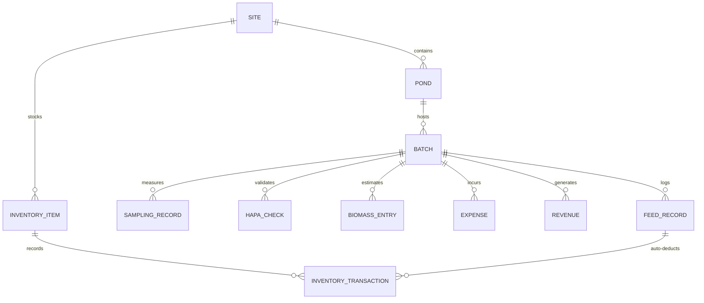
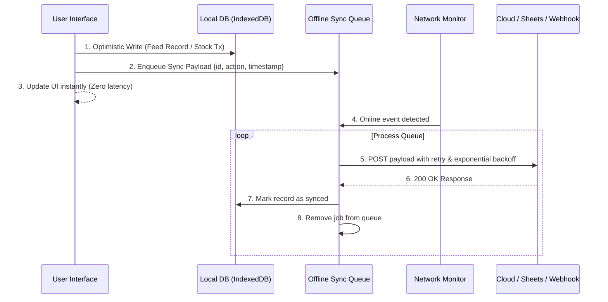

# 00 — Master System Architecture & Domain Audit

> **System-Wide Architecture, Data Dictionary, Mathematical Formats, and Google Stitch Re-Creation Blueprint**

---

## 1. Executive System Audit

### 1.1 Application Overview
**AquaLog** is an end-to-end Aquaculture Operating System designed specifically for commercial shrimp farm managers and rural farmers. It replaces paper logbooks with an intelligent, offline-capable digital ledger covering:
1. **Multi-Site & Multi-Pond Infrastructure**
2. **Precision Feed Management & Check-Tray Monitoring**
3. **Biomass, Growth (ADG), and Sampling Tracking**
4. **3-Pillar Farm Inventory (Feed, Medicine, Fuel)**
5. **Crop Finance, Cost Allocation, and Mandi Price Intelligence**
6. **Weather-Adaptive Feeding Guidance & Predictive Health Scoring**
7. **Offline-First PWA Synchronization (Google Sheets & Custom REST API)**

### 1.2 Current Implementation Analysis
- **Current Stack**: Single-page vanilla HTML5 (`index.html`, 2,855 lines), vanilla ES6 (`script.js` 17,453 lines, `extra-features.js` 5,690 lines, `features.js` ~1,000 lines, `ambient.js` 221 lines), and vanilla CSS (`style.css` 11,901 lines, `enhancements.css` 4,000+ lines).
- **Storage Layer**: Direct synchronous `localStorage` reads/writes with manual JSON parsing and serialization.
- **Rendering Model**: Direct DOM manipulation via string concatenation and innerHTML replacement, synchronized with periodic intervals (2.5s registry).
- **Core Strengths**: Unbelievably rich domain logic, deep aquaculture domain modeling (hapa checks, cast net math, feed tables, FCR evolution, tray percentage cuts), bilingual English/Hindi interface, and robust offline PWA caching.
- **Current Limitations / Architectural Debt**:
  - Monolithic scripts exceeding 25,000 combined lines lead to maintenance overhead and fragile state synchronization.
  - `localStorage` size limit (~5MB) will hit capacity after multiple seasons with hundreds of feeding logs and inventory transactions.
  - String concatenation in DOM manipulation introduces potential layout thrashing and UI jitter during tab switches.
  - Periodic polling intervals (2.5s) consume unnecessary mobile battery.

### 1.3 Recommended Google Stitch Modern Stack
To recreate AquaLog at the highest standard of modern web applications:
- **Framework**: **Next.js 15 (App Router)** or **Vite + React 19**
- **Language**: **TypeScript 5.x** (Strict null checks, comprehensive domain interfaces)
- **Styling**: **Tailwind CSS v4** + CSS Modules / Vanilla CSS design tokens (preserving glassmorphism, glowing neons, and dark aquaculture palettes)
- **State Management**: **Zustand** (with `persist` middleware) for application state, active batch contexts, and user preferences.
- **Client Storage**: **IndexedDB via Dexie.js** (unlimited storage capacity, structured querying, transactional integrity, multi-crop history).
- **Data Fetching / Sync**: **TanStack Query (React Query v5)** for optimistic UI updates, background synchronization, and network status caching.
- **Charts / Visualizations**: **Recharts** or **Chart.js 4.4+** with custom canvas tooltips and responsive wrappers.
- **Icons**: **Lucide React** + Tabler Icons.
- **Internationalization**: `next-intl` or `i18next` with bilingual English and Hindi (`Noto Sans Devanagari`).

---

## 2. Global Data Dictionary & Storage Schemas

AquaLog organizes its domain across 18 distinct LocalStorage keys (to be mapped to IndexedDB tables in the Google Stitch recreation):



### 2.1 Farm Sites (`al_sites`)
Stores geographic locations and metadata for multi-site farming operations.
```typescript
interface FarmSite {
  id: string;               // e.g. "site_1709726400000_abc"
  name: string;             // e.g. "Coastal Farm Site 1"
  address?: string;         // e.g. "Bhimavaram, Andhra Pradesh"
  latitude?: number;        // e.g. 16.5449
  longitude?: number;       // e.g. 81.5212
  pondCount?: number;       // Denormalized count
  createdAt: string;        // ISO 8601
  updatedAt: string;        // ISO 8601
}
```

### 2.2 Ponds (`al_ponds`)
Represents aquaculture water bodies.
```typescript
interface Pond {
  id: string;               // e.g. "pond_1", "demo_pond_1"
  siteId?: string;          // Foreign key -> FarmSite.id
  name: string;             // e.g. "Pond 1 (North)"
  areaSqMeters: number;     // e.g. 4000 (0.4 hectare)
  waterDepthMeters: number; // e.g. 1.5
  aeratorsCount: number;    // e.g. 8
  totalAeratorHp: number;   // e.g. 16 (8 x 2HP)
  status: 'active' | 'inactive' | 'archived';
  notes?: string;
  createdAt: string;
}
```

### 2.3 Batches / Crops (`al_batches`)
Represents a shrimp culture cycle stocked into a specific pond.
```typescript
interface Batch {
  id: string;               // e.g. "batch_1709726400000_xyz"
  pondId: string;           // Foreign key -> Pond.id
  batchNumber: number;      // Incremental per pond (e.g. 1, 2, 3)
  species: string;          // e.g. "Litopenaeus vannamei" | "Penaeus monodon"
  stockingDate: string;     // "YYYY-MM-DD"
  shrimpCount: number;      // Stocked pieces, e.g. 120,000
  plStage: string;          // e.g. "PL-10", "PL-12"
  seedSource?: string;      // Hatchery name, e.g. "Apex Hatcheries"
  seedCost?: number;        // Total seed expense in ₹
  targetHarvestWeightG: number; // e.g. 25.0
  status: 'active' | 'completed';
  
  // Hapa Survival Net Results
  hapaStocked?: number;     // Initial count in hapa net, default 100
  hapaAlive?: number;       // Alive count after 24-72 hrs, e.g. 96
  survivalRate?: number;    // In %, e.g. 96.0

  // Harvest Completion Data (when status === 'completed')
  completedAt?: string;     // ISO 8601
  harvestDate?: string;     // "YYYY-MM-DD"
  harvestWeightKg?: number; // Total harvest weight, e.g. 2,450 kg
  harvestCount?: number;    // Count at harvest, e.g. 98,000 pieces
  harvestAbwG?: number;     // Harvest Average Body Weight, e.g. 25.0g
  harvestType?: 'full' | 'partial';
  buyerName?: string;       // e.g. "Falcon Marine Exports"
  pricePerKg?: number;      // Sale price in ₹, e.g. 420
  harvestRevenue?: number;  // harvestWeightKg * pricePerKg
  actualFCR?: number;       // Total feed kg / harvest weight kg
  actualSurvivalRate?: number; // (harvestCount / shrimpCount) * 100
  netProfit?: number;       // harvestRevenue - totalExpenses
}
```

### 2.4 Feed Records (`al_records`)
Granular record for every feeding session.
```typescript
interface FeedRecord {
  Id: string;               // e.g. "rec_1709726400000_1"
  BatchId: string;          // Foreign key -> Batch.id
  PondId: string;           // Foreign key -> Pond.id
  Date: string;             // "YYYY-MM-DD"
  Time: string;             // "7:00 AM" | "11:00 AM" | "4:00 PM" | "7:00 PM" | custom "HH:MM"
  
  // Multi-feed breakdown (amounts in grams)
  Feed1: number;            // Starter 0.8mm / Nursery (g)
  Feed2: number;            // Grower 1.2mm (g)
  Feed3: number;            // Grower 1.6mm (g)
  Feed4: number;            // Finisher 2.0mm (g)
  Feed5: number;            // Finisher 2.5mm (g)
  OtherFeedName?: string;   // Custom feed name
  OtherFeedQty?: number;    // Custom feed qty (g)
  TotalGrams: number;       // Sum of all feed types in grams
  
  // Check-Tray Assessment
  trayChecked?: boolean;
  trayLeftoverPct?: number; // 0, 10, 25, 50, 75, 100%
  trayCondition?: 'clean' | 'normal' | 'excess_leftover';
  feedAdjustmentPct?: number; // Suggested adjustment (+5% to -20%)

  // Co-fed Medicine / Supplements
  medicines?: Array<{
    itemId?: string;        // Foreign key -> InventoryItem.id
    name: string;           // e.g. "Gut Probiotic"
    qty: number;            // e.g. 50
    unit: string;           // "g" | "ml" | "kg"
  }>;

  notes?: string;           // Farm observations
  syncedToSheets?: boolean; // Google Sheets sync flag
  syncedToApi?: boolean;    // Custom REST API sync flag
  createdAt: string;        // ISO 8601
}
```

### 2.5 Sampling Entries (`al_sampling`)
Cast net sampling records used to calculate Average Body Weight (ABW) and growth curves.
```typescript
interface SamplingRecord {
  id: string;               // e.g. "smp_1709726400000"
  batchId: string;          // Foreign key -> Batch.id
  date: string;             // "YYYY-MM-DD"
  doc: number;              // Day of Culture at sampling
  totalWeightG: number;     // Total weight of sampled shrimp in grams
  shrimpCount: number;      // Number of shrimp sampled
  abw: number;              // Average Body Weight = totalWeightG / shrimpCount
  growthSincePrev?: number; // abw - previousSampling.abw
  daysSincePrev?: number;   // days between samplings
  dailyGrowth?: number;     // Average Daily Growth (ADG) in g/day
  notes?: string;
  createdAt: string;
}
```

### 2.6 Hapa Survival Checks (`al_hapa`)
Survival net monitoring records installed at stocking.
```typescript
interface HapaRecord {
  id: string;               // e.g. "hapa_1709726400000"
  batchId: string;          // Foreign key -> Batch.id
  date: string;             // Check date
  checkHours: number;       // 24, 48, or 72 hours post stocking
  stockedCount: number;     // Usually 100
  aliveCount: number;       // e.g. 94
  survivalPercent: number;  // (aliveCount / stockedCount) * 100
  estimatedPondPopulation: number; // batch.shrimpCount * (survivalPercent / 100)
  createdAt: string;
}
```

### 2.7 Visual Weight Estimations (`al_growth`)
Quick visual or manual weight estimations when cast netting is not performed.
```typescript
interface GrowthRecord {
  id: string;
  batchId: string;
  date: string;
  doc: number;
  weightGrams: number;      // Estimated ABW
  notes?: string;
  createdAt: string;
}
```

### 2.8 Biomass Audit Ledger (`al_biomass`)
Historical snapshot of calculated biomass.
```typescript
interface BiomassRecord {
  id: string;
  batchId: string;
  date: string;
  doc: number;
  estimatedPopulation: number;
  abw: number;
  abwSource: 'sampling' | 'visual_estimation';
  biomassKg: number;
  createdAt: string;
}
```

### 2.9 Inventory Items & Transactions (`al_inventory`)
Three-pillar inventory engine: Feed, Medicine, Fuel.
```typescript
interface InventoryItem {
  id: string;               // e.g. "inv_feed_starter_08"
  siteId?: string;
  category: 'feed' | 'medicine' | 'fuel';
  name: string;             // e.g. "Grower Pellet 1.6mm", "Diesel", "Probiotic A"
  brand?: string;           // e.g. "CP", "Avanti", "Grobest"
  pelletSize?: string;      // e.g. "1.6mm"
  medicineCategory?: 'Probiotics' | 'Minerals' | 'Lime' | 'Disinfectants' | 'Vitamins' | 'Water Treatment';
  fuelType?: 'Diesel' | 'Petrol' | 'Engine Oil';
  unit: 'kg' | 'L' | 'units' | 'bottles' | 'packs';
  bagWeightKg?: number;     // e.g. 25 for feed bags
  currentStock: number;     // Net quantity in base unit (kg, L, units)
  lowStockThreshold: number;// Configurable warning threshold
  costPerUnit: number;      // Cost in ₹ per unit
  supplier?: string;        // e.g. "Shree Agro Feeds"
  batchLotNumber?: string;
  expiryDate?: string;      // "YYYY-MM-DD"
  createdAt: string;
  updatedAt: string;
}

interface InventoryTransaction {
  id: string;
  itemId: string;           // Foreign key -> InventoryItem.id
  type: 'purchase' | 'consumption' | 'manual_adjustment' | 'transfer_in' | 'transfer_out' | 'expired' | 'damaged';
  quantity: number;         // Delta quantity
  unitPrice?: number;       // Purchase price per unit
  totalCost?: number;       // Total transaction cost
  date: string;
  referenceRecordId?: string; // Foreign key -> FeedRecord.Id if auto-deducted
  notes?: string;
  createdAt: string;
}
```

### 2.10 Finance: Expenses, Revenue & Market Prices
```typescript
interface FinanceExpense {
  id: string;               // e.g. "exp_1709726400000"
  date: string;
  category: 'feed' | 'seed' | 'labor' | 'electricity' | 'fuel' | 'medicine' | 'maintenance' | 'rent' | 'equipment' | 'other';
  amount: number;           // ₹
  description: string;
  batchId?: string;         // Optional batch attribution
  pondId?: string;
  siteId?: string;
  inventoryTxId?: string;   // Link to inventory purchase if auto-created
  createdAt: string;
}

interface FinanceRevenue {
  id: string;               // e.g. "rev_1709726400000"
  date: string;
  batchId: string;          // Foreign key -> Batch.id
  weightKg: number;         // Total weight sold
  pricePerKg: number;       // Selling price ₹/kg
  totalAmount: number;      // weightKg * pricePerKg
  buyer: string;            // Buyer / exporter name
  paymentStatus: 'paid' | 'partial' | 'pending';
  createdAt: string;
}

interface MarketPrice {
  id: string;
  date: string;
  pricePerKg: number;       // ₹/kg
  sizeCategory?: string;    // e.g. "30 count (33g)", "40 count (25g)", "60 count (16g)", "100 count (10g)"
  location?: string;        // e.g. "Bhimavaram Mandi", "Nellore"
  createdAt: string;
}
```

---

## 3. Mathematical Formulas & Algorithmic Rules

Every formula implemented across `script.js` and `extra-features.js` must be strictly preserved in Google Stitch:

### 3.1 Days of Culture (DOC)
$$DOC = \lfloor \frac{\text{Current Date (Start of Day)} - \text{Stocking Date (Start of Day)}}{86,400,000 \text{ ms}} \rfloor + 1$$
- **Rule**: If Current Date equals Stocking Date, $DOC = 1$.
- **Edge Case**: If stocking date is in the future, $DOC = 1$ with a warning flag.
- **Stocking Date Modification**: If a batch's stocking date is edited, a warning modal (`batchDateWarnModal`) alerts the user that all historical sampling DOCs, timeline charts, and feeding age benchmarks will be recalculated.

### 3.2 Live Average Body Weight (ABW)
$$\text{ABW (grams)} = \frac{\text{Sample Total Weight (grams)}}{\text{Sample Shrimp Count (pieces)}}$$
- **Precision**: Rounded to 2 or 3 decimal places (e.g., $18.45\text{g}$).
- **Validation**: Both weight and count must be strictly $> 0$. Count must be an integer.

### 3.3 Average Daily Growth (ADG)
$$ADG = \frac{\text{ABW}_{\text{current}} - \text{ABW}_{\text{previous}}}{\text{DOC}_{\text{current}} - \text{DOC}_{\text{previous}}} \quad (\text{grams / day})$$
- **Benchmark Evaluation**:
  - $ADG \ge 0.30\text{ g/day}$: Excellent growth.
  - $0.20 \le ADG < 0.30\text{ g/day}$: Normal / standard commercial growth.
  - $0.10 \le ADG < 0.20\text{ g/day}$: Slow growth (triggers alert).
  - $ADG < 0.10\text{ g/day}$ or negative: Critical Growth Stalling alert!

### 3.4 Population & Biomass Estimation
$$N_{\text{estimated}} = \text{Stocked Shrimp Count} \times \left( \frac{\text{Hapa Survival \%}}{100} \right)$$
$$\text{Biomass (kg)} = \frac{N_{\text{estimated}} \times \text{Latest ABW (g)}}{1,000}$$
- **Fallback Hierarchy for ABW**:
  1. Latest Cast Net Sampling ABW (`al_sampling`).
  2. If missing, Visual Estimation ABW (`al_growth`) with warning: *"Sampling ABW missing, using Visual Estimation"*.
  3. If both missing, status is `ABW_MISSING` and biomass returns `null`.
- **Fallback Hierarchy for Survival**:
  1. Hapa check survival % (`al_hapa`).
  2. If missing, defaults to batch `survivalRate` if provided.
  3. If missing, status is `HAPA_MISSING` and biomass returns `null`.

### 3.5 Feed Conversion Ratio (FCR)

#### A. Cumulative Actual FCR (At Harvest)
$$\text{Actual FCR} = \frac{\sum \text{Cumulative Feed (kg)}}{\text{Total Harvest Weight (kg)}}$$

#### B. Estimated Current FCR (During Culture)
$$\text{Estimated FCR} = \frac{\sum \text{Cumulative Feed to Date (kg)}}{\text{Current Estimated Biomass (kg)}}$$

#### C. Period-by-Period Incremental FCR (Between Two Samplings)
$$\text{Period FCR} = \frac{\text{Feed Fed between Date}_1 \text{ and Date}_2 \text{ (kg)}}{\text{Biomass}_2 - \text{Biomass}_1 \text{ (kg)}}$$
- **Edge Case**: If $\text{Biomass}_2 \le \text{Biomass}_1$, biomass gain is $\le 0$, FCR is mathematically undefined, and a warning *"Biomass gain $\le 0$"* is rendered.

### 3.6 Check-Tray Assessment & Feed Adjustment Feedback Loop
Check trays are inspected 1.5 to 2.0 hours after broadcasting feed.

| Tray Leftover Observed | Assessment | Next Feed Adjustment | Recommendation Text |
| :--- | :--- | :--- | :--- |
| **0% (Clean tray)** | Vigorous appetite | **+5% to +10%** | *"Tray completely clean. Increase next feed by 5-10%."* |
| **1% - 10% Leftover** | Optimal appetite | **0% (Maintain)** | *"Normal feeding rate. Maintain current schedule."* |
| **11% - 25% Leftover** | Mild overfeed / sluggish | **-10% to -15%** | *"Slight leftover. Cut next feed by 10-15% to prevent water fouling."* |
| **> 25% Leftover** | Heavy overfeed / stress | **-25% to -50%** | *"Excess feed detected! Cut next feed by 30-50% immediately, check DO & water parameters."* |

### 3.7 Weather-Adaptive Feeding Engine (`FeedRecommendationEngine`)
Calculates real-time feeding adjustments from local weather parameters:
- **High Temperature ($T \ge 34^\circ\text{C}$)**: Status `high-temp`. Actions: *Feed during cooler hours (early morning/evening), reduce afternoon feed by 20%, increase aerator run-time*.
- **Low Temperature ($T \le 26^\circ\text{C}$)**: Status `low-temp`. Shrimp metabolism drops sharply. Actions: *Reduce feed by 15-25%, monitor check trays closely*.
- **Ideal Range ($28^\circ\text{C} \le T \le 32^\circ\text{C}$)**: Status `normal`. Actions: *Optimal metabolic temperature. Continue standard feeding schedule*.
- **High Rain Probability ($Rain \ge 70\%$)**: Status `rain-risk`. Heavy rain alters pond salinity and surface pH. Actions: *Cut feed by 25-30%. Resume standard feeding only after rain clears*.
- **High Humidity + High Temp ($H \ge 80\% \text{ and } T \ge 30^\circ\text{C}$)**: Status `humidity-risk`. Elevated danger of night-time Dissolved Oxygen (DO) depletion. Actions: *Increase mechanical aeration duration*.

### 3.8 Pond Health Score (0 - 100 Algorithm)
The composite health score evaluates four distinct operational pillars:
$$Score = P_{\text{consistency}} (35) + P_{\text{activity}} (20) + P_{\text{growth}} (25) + P_{\text{survival}} (20)$$

1. **Feed Consistency (0 - 35 pts)**:
   - Percentage of scheduled sessions logged in the last 7 days ($4 \text{ sessions/day} \times 7 = 28 \text{ target}$).
   - $\ge 90\% \rightarrow 35\text{ pts}$; $75-89\% \rightarrow 25\text{ pts}$; $< 75\% \rightarrow 10\text{ pts}$.
2. **Recent Activity (0 - 20 pts)**:
   - Active logs in last 3 days. Active logs today: +10 pts; yesterday: +6 pts; day before: +4 pts.
3. **Growth Rate / ADG (0 - 25 pts)**:
   - $ADG \ge 0.25\text{g/day} \rightarrow 25\text{ pts}$.
   - $0.18 - 0.24\text{g/day} \rightarrow 18\text{ pts}$.
   - $0.10 - 0.17\text{g/day} \rightarrow 10\text{ pts}$.
   - $< 0.10\text{g/day} \rightarrow 0\text{ pts}$.
4. **Survival Rate (0 - 20 pts)**:
   - Hapa survival $\ge 90\% \rightarrow 20\text{ pts}$; $80-89\% \rightarrow 14\text{ pts}$; $< 80\% \rightarrow 5\text{ pts}$.

### 3.9 Harvest Date Predictor
$$\text{Days to Harvest} = \frac{\text{Target Harvest Weight (g)} - \text{Current ABW (g)}}{\text{Current ADG (g/day)}}$$
$$\text{Estimated Harvest Date} = \text{Current Date} + \text{Days to Harvest}$$
- **Fallback**: If ADG cannot be calculated (fewer than 2 samplings), uses the commercial standard rate of $0.22\text{ g/day}$ for *L. vannamei*.

### 3.10 Water Volume & Chemical Dosage
$$\text{Pond Water Volume } (m^3) = \text{Area } (m^2) \times \text{Average Depth } (m)$$
$$\text{Chemical Requirement } (kg \text{ or } L) = \frac{\text{Volume } (m^3) \times \text{Target Dosage } (ppm)}{1,000}$$
*(Note: $1\text{ ppm} = 1\text{ g/m}^3 = 1\text{ mg/L}$)*

### 3.11 Break-Even Shrimp Sale Price
$$\text{Break-Even Price } (₹/\text{kg}) = \frac{\text{Total Crop Expenses to Date } (₹)}{\text{Harvest Weight or Projected Biomass } (kg)}$$
- If current market price is ₹420/kg and break-even price is ₹280/kg, net profit is ₹140/kg ($33.3\%$ net margin).

---

## 4. Offline-First Architecture & Sync Lifecycle

Commercial shrimp farms are located along rural coastal estuaries with intermittent network connectivity. The system architecture must guarantee zero data loss:



### 4.1 Sync Payload Schema (`al_queue`)
```typescript
interface SyncJob {
  id: string;               // Unique job ID
  entityType: 'feed' | 'inventory' | 'sampling' | 'expense';
  entityId: string;
  action: 'create' | 'update' | 'delete';
  payload: any;
  retryCount: number;
  lastAttemptAt?: string;
  createdAt: string;
}
```

### 4.2 Webhook & Google Sheets Integration
- **Google Apps Script**: Sends an HTTP `POST` with `Content-Type: application/json` containing the normalized row data matching spreadsheet column headers: Date, Time, Pond, Batch, Starter, Grower, Finisher, Total (g), Notes.
- **Custom REST API**: Supports custom endpoints with user-defined HTTP method (`POST` or `PUT`), `Authorization` Bearer/ApiKey header, and arbitrary custom JSON headers.

---

## 5. Design Tokens & Visual Architecture

The visual theme combines the modern dark aesthetics of fintech apps with high-visibility aquatic elements:

| Token Name | CSS Value | Hex / Spec | Usage |
| :--- | :--- | :--- | :--- |
| `--bg` | `#040914` | Deep Ocean Navy | Main app background canvas |
| `--bg-2` | `#080f1e` | Midnight Navy | Cards, sheets, headers |
| `--bg-3` | `#0c152a` | Elevated Slate Navy | Secondary cards, modals |
| `--surface` | `rgba(255,255,255,0.03)` | 3% White | Glassmorphic card surfaces |
| `--surface-2` | `rgba(255,255,255,0.05)` | 5% White | Hover states, active tabs |
| `--teal` | `#00e5f5` | Bright Cyan-Teal | Primary brand accent, hero numbers, active icons |
| `--teal-dim` | `#0097a7` | Deep Teal | Inactive toggles, secondary buttons |
| `--teal-glow`| `rgba(0,229,245,0.22)` | Neon Glow | Shadows on active buttons and primary cards |
| `--cyan` | `#38bdf8` | Sky Blue | Secondary accent, feed size 1, DOC chips |
| `--amber` | `#fbbf24` | Golden Amber | Warnings, check-tray alerts, expiry notices |
| `--red` | `#f43f5e` | Crimson Rose | Critical alerts, out of stock, negative profit |
| `--green` | `#10b981` | Emerald Green | Completed status, healthy score, positive profit |
| `--t1` | `#f1f5f9` | Slate 100 | Primary headings, titles, inputs |
| `--t2` | `#94a3b8` | Slate 400 | Subheadings, field labels, metadata |
| `--t3` | `#475569` | Slate 600 | Placeholder text, disabled controls |
| `--fh` | `'Outfit', sans-serif` | Geometric Display | Headings, hero metrics, card titles |
| `--fb` | `'Plus Jakarta Sans', sans-serif` | Clean Grotesk | Body copy, forms, tables |
| `--f-hi` | `'Noto Sans Devanagari', sans-serif` | Devanagari | Hindi translations and bilingual tags |

### 5.1 Outdoor Sunlight Mode
In direct sunlight by the pond, farmers can toggle **Outdoor Mode**:
- Background shifts from translucent dark glass to high-contrast deep black (`#000000`).
- Text contrast is boosted to pure white (`#ffffff`).
- Borders thicken to $2\text{px}$ solid with $100\%$ opaque accent badges.

---

## 6. Structural Blueprint for Google Stitch

When feeding these markdown files into Google Stitch:
1. **Modular Screen Generation**: Recreate each screen independently following its specific screen specification (`01` through `11`).
2. **Shared Component Extraction**:
   - `HeroMetricCard`: Reusable glassmorphic hero container.
   - `ContextSelector`: Farm site / pond / batch dropdown capsule.
   - `PondStrip`: Horizontal scrolling pill list for ponds.
   - `CheckTrayScorer`: Visual dial / segment button for tray leftovers.
   - `MetricRow`: Standard label-value row with color-coded status pills.
   - `BilingualLabel`: Container rendering English title with Hindi subtitle (`Noto Sans Devanagari`).
   - `OfflineBanner`: Floating badge indicating pending sync items.
3. **Database Layer**: Bind the domain models directly to IndexedDB via Dexie.js hooks (`useLiveQuery`).
