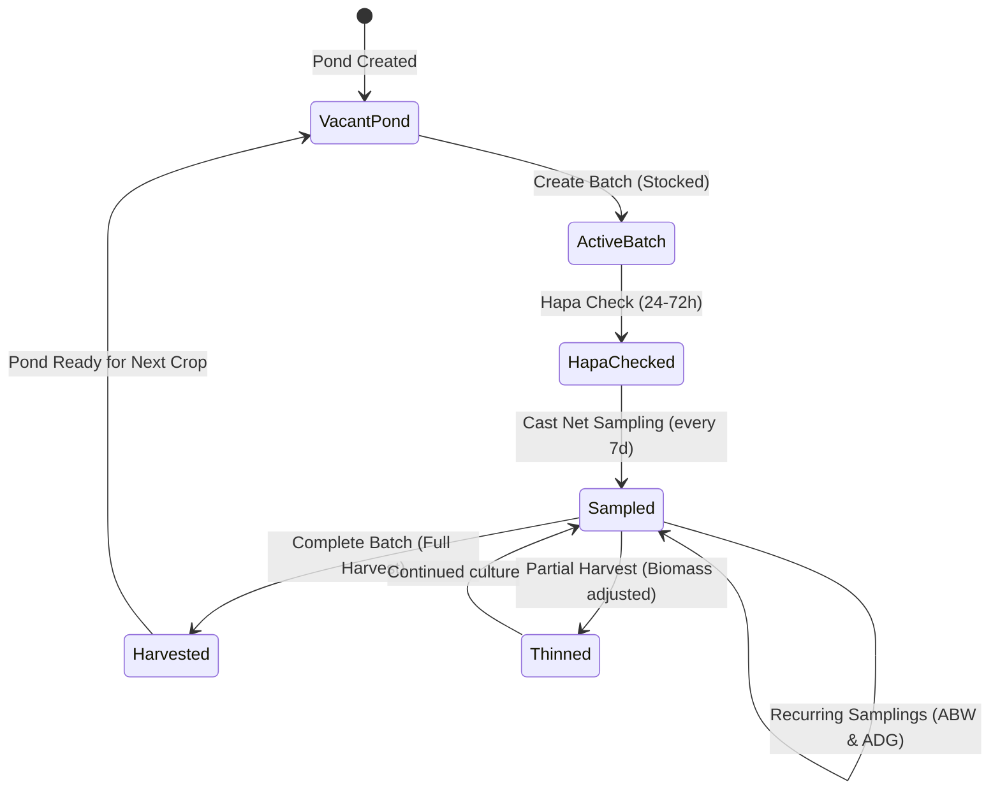

# 03 — Screen Specification: Manage Ponds, Batches & Sites

> **Screen ID**: `pageManage`  
> **Route / Navigation**: Bottom Nav "Manage" (`data-tab="manage"`) | Keyboard Shortcut `g` then `m`  
> **Target Component**: `<ManagePage />`

---

## 1. Screen Objective & User Mental Model

Aquaculture operations run on a structured geographic and biological hierarchy:
$$\text{Farm Site} \longrightarrow \text{Ponds} \longrightarrow \text{Batches (Culture Cycles)}$$

The **Manage Screen** is the administrative and biological backbone of the farm. From this screen, the farm manager:
1. **Configures Infrastructure**: Sets up sites, adds ponds, defines surface areas, water depths, and aerator capacities.
2. **Tracks Lifecycle Progression**: Monitors crop age through 5 standardized stages (Nursery $\rightarrow$ Growout Early $\rightarrow$ Growout Mid $\rightarrow$ Finishing $\rightarrow$ Harvest Ready).
3. **Conducts Biological Monitoring**: Logs Cast Net Samplings (calculating live ABW and ADG) and Hapa Survival Net Checks.
4. **Executes Crop Lifecycle Events**: Stocks new PL seed, logs visual weights, and carries out Final or Partial Harvests with automatic P&L and FCR reconciliation.

---

## 2. Visual Hierarchy & Screen Structure

```
<ManagePage>
  ├── <ScreenHeroHeader> ("🌊 Manage" · "तालाब प्रबंधन · Ponds & Batches")
  │
  ├── <PrimaryActionCardsGrid> (3 quick-stat navigation cards)
  │     ├── <SitesCard> (📍 "Sites" · "X sites" · Toggles Sites Drawer)
  │     ├── <PondsCard> (🏊 "Ponds" · "X ponds")
  │     └── <BatchesCard> (🦐 "Batches" · "X active")
  │
  ├── <CreatePondCTAButton> ("＋ Create Pond · नया तालाब")
  │
  ├── <ActivePondChipsBar> (Horizontal scrollable chip strip synchronized with carousel below)
  │
  ├── <PondCardsPager> (Horizontal swipe carousel or responsive grid of Active Ponds)
  │     └── <PondCard>
  │           ├── <CardHeader> (Pond name, Site tag, Lifecycle stage badge, Status)
  │           ├── <PhysicalSpecsRow> (Area m², Depth m, Aerators count & total HP)
  │           ├── <ActiveBatchSection> (If stocked: Batch #, DOC, Species, Count, ABW, Biomass)
  │           ├── <VacantPondSection> (If unstocked: "Vacant · Ready to Stock" + CTA)
  │           └── <PondActionButtons>
  │                 ├── <EditPondBtn> ───> opens <EditPondModal>
  │                 ├── <StockBatchBtn> ──> opens <CreateBatchModal>
  │                 ├── <SampleBtn> ──────> opens <SamplingEntryModal>
  │                 ├── <HapaBtn> ────────> opens <HapaEntryModal>
  │                 ├── <WeightBtn> ──────> opens <LogWeightModal>
  │                 ├── <HarvestBtn> ─────> opens <CompleteBatchModal>
  │                 └── <ArchivePondBtn> ─> opens <ArchivePondModal>
  │
  ├── <InactivePondsCollapsible> (Archived/fallow ponds with restore option)
  │
  ├── <ToolsAndAnalyticsCollapsible> (Multi-batch overlay curves, pond comparison tools)
  │
  ├── <CompletedBatchesCollapsible> (Historical harvested crops ledger with FCR and profit stats)
  │
  └── <FarmSitesSection> (Multi-site management, coordinates, and weather station setup)
```

---

## 3. UI Specifications & Styling Tokens

- **Primary Action Cards (`.manage-primary-card`)**: 3-column top grid (`grid-template-columns: repeat(3, 1fr); gap: 10px`).
  - Card background: `rgba(255,255,255,0.03); border: 1px solid var(--border); border-radius: 14px; padding: 12px 8px; text-align: center`.
  - Icon: Font-size $1.6\text{rem}$. Count: `--teal: #00e5f5`, font-weight 700.
- **Pond Card Carousel (`#managePondPager`)**:
  - Desktop: Multi-column CSS grid (`grid-template-columns: repeat(auto-fill, minmax(360px, 1fr)); gap: 16px`).
  - Mobile: Full-width snap-scrolling carousel (`scroll-snap-type: x mandatory; display: flex; overflow-x: auto; gap: 12px; padding: 0 16px`).
- **Lifecycle Stage Badge (`.aq-lifecycle-badge`)**:
  - Embedded in top right of each pond card.
  - Border: $1.5\text{px}$ solid stage color.
  - Background: Semi-transparent tinted background ($12\%$ opacity).
  - Contains emoji icon, stage title, and current DOC badge.
- **Pond Spec Pills**: Subtle slate badges (`background: rgba(255,255,255,0.04); font-size: 0.78rem; padding: 4px 8px; border-radius: 6px`).

---

## 4. Lifecycle Stages & Mathematical Formulas

### 4.1 The 5 Shrimp Culture Lifecycle Stages
The system dynamically categorizes every active batch based on its Days of Culture (DOC):

| Stage Name | DOC Range | Theme Color | Icon | Biological & Feeding Characteristics |
| :--- | :--- | :--- | :--- | :--- |
| **Nursery** | DOC 0 – 25 | Sky Blue (`#38bdf8`) | 🌱 | Fragile PL stage (PL-10 to PL-25). Blind feeding in blind corners. Starter crumble feed. Hapa checks conducted. |
| **Growout Early** | DOC 26 – 60 | Ocean Teal (`#00e5f5`) | 🌿 | Rapid juvenile growth. Transition from Starter to Grower 1.2mm / 1.6mm. Check trays introduced at DOC 30. |
| **Growout Mid** | DOC 61 – 90 | Emerald Green (`#10b981`) | 🐟 | Peak exponential biomass expansion. Feeding 4 times daily. Routine cast netting every 7 days. High aeration demand. |
| **Finishing** | DOC 91 – 120 | Amber Gold (`#fbbf24`) | ⚖️ | Shrimp size 18g – 25g. Transition to Finisher 2.0mm / 2.5mm. Feed adjustments critical to avoid oxygen dips. |
| **Harvest Ready** | DOC > 120 | Crimson Rose (`#f43f5e`) | 🎯 | Target harvest weight reached (>25g). Market price monitoring daily. High risk of bottom fouling; harvest scheduled. |

### 4.2 Cast Net Sampling Mathematics (`samplingEntryModal`)
Cast netting involves throwing a circular net of known radius to capture a representative sample of shrimp:
1. **Inputs**:
   - `samplingTotalWeight` (g): Net weight of all captured shrimp (e.g. $475.5\text{g}$).
   - `samplingShrimpCount` (pieces): Exact count of shrimp in net (e.g. $25\text{ pieces}$).
2. **Calculated Live ABW (Average Body Weight)**:
   $$\text{ABW} = \frac{\text{samplingTotalWeight}}{\text{samplingShrimpCount}} = \frac{475.5}{25} = 19.02\text{ grams}$$
3. **Growth Since Previous Sampling**:
   $$\Delta \text{Weight} = \text{ABW}_{\text{current}} - \text{ABW}_{\text{previous}}$$
4. **Days Between Samplings**:
   $$\Delta \text{Days} = \lfloor \frac{\text{Date}_{\text{current}} - \text{Date}_{\text{previous}}}{86,400,000} \rfloor$$
5. **Average Daily Growth (ADG)**:
   $$ADG = \frac{\Delta \text{Weight}}{\Delta \text{Days}} \quad (\text{grams / day})$$
   *Example: Current ABW $19.02\text{g}$, previous ABW $16.92\text{g}$, 7 days elapsed:*
   $$ADG = \frac{19.02 - 16.92}{7} = \frac{2.10}{7} = 0.30\text{ g/day} \quad (\text{Excellent})$$

### 4.3 Hapa Survival Net Check Mathematics (`hapaEntryModal`)
At stocking, $100$ post-larvae are placed inside a fine mesh hapa net floating in the pond to assess transport and acclimatization survival:
1. **Inputs**:
   - `hapaStocked`: Default $100$ pieces.
   - `hapaAlive`: Surviving count after 24 to 72 hours (e.g. $96$ pieces).
2. **Calculated Survival Rate**:
   $$\text{Survival \%} = \left( \frac{\text{hapaAlive}}{\text{hapaStocked}} \right) \times 100 = \left( \frac{96}{100} \right) \times 100 = 96.0\%$$
3. **Projected Total Pond Population**:
   $$N_{\text{estimated}} = \text{Batch Stocked Count} \times \left( \frac{\text{Survival \%}}{100} \right)$$
   *Example: Stocked $120,000$ post-larvae with $96.0\%$ survival:*
   $$N_{\text{estimated}} = 120,000 \times 0.96 = 115,200\text{ live shrimp}$$
4. **Estimated Biomass**:
   $$\text{Biomass (kg)} = \frac{N_{\text{estimated}} \times \text{Latest ABW (g)}}{1,000}$$
   *Example: $115,200\text{ shrimp} \times 19.02\text{g} = 2,191.1\text{ kg}$*.

### 4.4 Crop Completion / Harvest Mathematics (`completeBatchModal`)
When a crop is harvested (either partial netting or final pond draining):
1. **Inputs**:
   - `harvestDate`: "YYYY-MM-DD"
   - `harvestWeightKg`: Total harvested weight (e.g. $2,450\text{ kg}$).
   - `harvestCount`: Total count in pieces (or calculated via harvest ABW).
   - `harvestType`: `'full'` (closes batch) or `'partial'` (thins biomass, leaves remainder in pond).
   - `buyerName`: Exporter / processing plant name.
   - `pricePerKg`: Sale price per kg in ₹ (e.g. ₹$420$).
2. **Calculated Metrics**:
   - **Harvest Average Body Weight**:
     $$\text{Harvest ABW (g)} = \frac{\text{harvestWeightKg} \times 1,000}{\text{harvestCount}}$$
   - **Total Harvest Revenue**:
     $$\text{Revenue (₹)} = \text{harvestWeightKg} \times \text{pricePerKg} = 2,450 \times 420 = ₹1,029,000$$
   - **Actual Cumulative FCR**:
     $$\text{Actual FCR} = \frac{\sum \text{Cumulative Feed (kg)}}{\text{harvestWeightKg}} = \frac{3,185\text{ kg}}{2,450\text{ kg}} = 1.30$$
   - **Actual Survival Rate**:
     $$\text{Actual Survival \%} = \left( \frac{\text{harvestCount}}{\text{Initial Stocked Count}} \right) \times 100$$
   - **Net Profit / Loss**:
     $$\text{Net Profit (₹)} = \text{Revenue} - \text{Total Batch Expenses (Seed, Feed, Power, Labor, Meds)}$$

---

## 5. Exhaustive Specification of All 12 Modals

### 5.1 Create Pond Modal (`#createPondModal`)
- **Fields**:
  - Pond Name (`#createPondName`): text, required (e.g. "Pond 1 - North").
  - Farm Site (`#createPondSite`): select dropdown, optional site attribution.
  - Surface Area (`#createPondArea`): number, $m^2$, required (e.g. `4000`).
  - Average Depth (`#createPondDepth`): number, meters, required (e.g. `1.5`).
  - Aerators Count (`#createPondAerators`): number, required (e.g. `8`).
  - Total Aerator HP (`#createPondHp`): number, HP (e.g. `16`).
- **Validation**: Name unique, Area $> 0$, Depth $> 0$.
- **On Submit**: Generates `id = "pond_" + Date.now()`, sets `status = 'active'`, saves to `al_ponds`, refreshes carousel.

### 5.2 Edit Pond Modal (`#editPondModal`)
- Modifies physical attributes of an existing pond.
- Allows changing name, site assignment, depth, aerator configuration.

### 5.3 Archive Pond Modal (`#archivePondModal`)
- Sets `pond.status = 'archived'`.
- Removes pond from active feed logging dropdowns and dashboard timeline.
- Moves pond card to the collapsed `#inactiveSection`.
- Prevents archiving if an active batch is currently stocked!

### 5.4 Delete Pond Modal (`#deletePondModal`)
- High-risk permanent deletion (`#deletePondModalTitle`: *"Delete Pond Permanently?"*).
- **Rule**: Deletion is blocked if the pond contains any historical batches or records to prevent database corruption. User is advised to Archive instead.

### 5.5 Create Farm Site Modal (`#createSiteModal`)
- **Fields**: Site Name, Address, Latitude, Longitude.
- **GPS Integration**: Includes button `[ 📍 Detect GPS ]` which invokes `LocationService.getCurrentGPSLocation()` via browser geolocation and reverse-geocodes via OpenStreetMap Nominatim.

### 5.6 Create Batch Modal (`#createBatchModal`)
- **Fields**:
  - Pond Context (`#createBatchPondContext`): Displays target pond name and area.
  - Batch Number (`#createBatchNum`): Auto-calculated incremental integer.
  - Species (`#createBatchSpecies`): Dropdown (*Litopenaeus vannamei* / *Penaeus monodon*).
  - Stocking Date (`#createBatchDate`): Date picker, defaults to today.
  - Shrimp Stocked Count (`#createBatchCount`): Number, e.g. `120000`.
  - Stocking Density Preview: Automatically calculated $\text{Density} = \frac{\text{Count}}{\text{Area } (m^2)}$ (e.g. `30.0 pcs/m²`).
  - Post-Larvae Stage (`#createBatchPl`): Text, e.g. "PL-10".
  - Hatchery Source (`#createBatchSource`): Text, e.g. "Apex Hatchery, Kakinada".
  - Seed Cost (`#createBatchCost`): Currency in ₹. Automatically logged as a seed expense in Finance!
  - Target Harvest Weight (`#createBatchTarget`): In grams, e.g. `25.0`.
- **On Submit**: Validates that target pond does not already have an active batch. Sets `batch.status = 'active'`. Saves to `al_batches`.

### 5.7 Edit Batch Modal (`#editBatchModal`) & Date Warning Modal (`#batchDateWarnModal`)
- Allows editing batch stocking parameters.
- **Critical Intercept**: If user changes the `stockingDate`:
  - Intercepts save and displays `#batchDateWarnModal`:
  - *"⚠️ Warning: Changing the stocking date will affect: Days of Culture (DOC) for all historical feed logs, sampling growth curves, and feeding age benchmarks. Continue?"*
  - Requires explicit confirmation button `[ Confirm Date Change ]` before recalculating.

### 5.8 View Batch Details Modal (`#viewBatchModal`)
- Deep audit sheet showing:
  - Batch metadata, PL age, hatchery source.
  - Complete historical timeline: Stocking date, Hapa check result, every sampling record.
  - Cumulative feed logged (kg), Total expenses to date (₹).
  - Current estimated biomass (kg), current estimated FCR.

### 5.9 Complete Batch / Harvest Modal (`#completeBatchModal`)
- Displays pre-harvest summary grid: Days Cultured, Est. Biomass, Est. FCR.
- Collects actual harvest figures: Harvest Date, Harvest Weight (kg), Shrimp Count, Price/kg, Buyer.
- Calculates live preview of: Actual FCR, Total Revenue, and Estimated Profit/Loss.
- On Confirm: Sets `batch.status = 'completed'`, stores harvest audit fields, automatically creates revenue entry in Finance, frees pond to "Vacant".

### 5.10 Visual Weight Logging Modal (`#logWeightModal`)
- Rapid weight entry when sampling nets are not used.
- Fields: Date, Calculated DOC, Estimated ABW (g), Notes.
- Saves to `al_growth`.

### 5.11 Sampling Entry Modal (`#samplingEntryModal`)
- Comprehensive Cast Net sampling modal.
- Fields: Date, Calculated DOC, Sample Total Weight (g), Sample Shrimp Count (pieces).
- Live ABW badge updates dynamically as user types weight and count.
- Recalculates $ADG$ and growth trends for all subsequent samplings.

### 5.12 Hapa Survival Net Modal (`#hapaEntryModal`)
- Initial survival verification modal.
- Fields: Stocked in Hapa ($100$), Alive Count.
- Displays live preview: Survival % and Projected live pond population.
- Updates `batch.survivalRate` and biomass models.

---

## 6. User Interactions & Event Flow



---

## 7. Google Stitch Re-Creation Recommendations

1. **Horizontal Swipe Physics**: Implement smooth touch carousel for pond cards using Framer Motion with snap points (`drag="x"` and `dragConstraints`).
2. **Visual Pond Status Gauge**: Render a dynamic water ripple / wave SVG animation inside each pond card with color reflecting health score.
3. **Inline Harvesting Wizard**: Create a stepped modal for Harvest: Step 1 (Biomass & Weights), Step 2 (Buyer & Financials), Step 3 (Summary & P&L celebration confetti).
